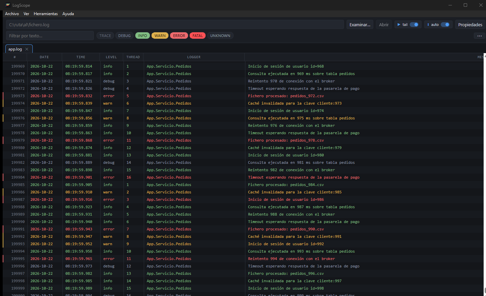

# LogScope

Visor de logs para Windows, rápido y sin dependencias comerciales. Abre ficheros
grandes sin bloquearse, reconoce el formato y la codificación por su cuenta y
deja seguir un log en vivo mientras se escribe.



## Qué hace

- **Abre logs enormes.** El visor solo pide al núcleo las filas que estás
  viendo, así que un fichero de cientos de miles de líneas se abre en segundos
  y el desplazamiento sigue siendo fluido.
- **Reconoce el formato solo.** Detecta la fecha y hora, el nivel, el hilo, la
  etiqueta, el logger y el mensaje sin configurar nada, y agrupa los registros
  que ocupan varias líneas.
- **Lee la codificación real del fichero.** UTF-8, UTF-16, UTF-32, las páginas
  de Windows y las de consola, y lo deduce cuando no hay pistas.
- **Filtra por nivel y por texto**, con los niveles a un clic.
- **Respeta la hora escrita**: las columnas de fecha y hora enseñan los dígitos
  del fichero, y si el log viene de otra zona horaria se indica en **Propiedades**
  para que el orden y los filtros por fecha usen el instante correcto.
- **Colorea** filas o palabras con reglas propias de cada log.
- **Sigue el fichero en vivo** con autoscroll, y avisa al rotar o truncarse.
- **Pestañas y vista combinada**: varios logs abiertos a la vez, o
  entremezclados por instante en una sola vista.
- **Arrastrar y soltar**: suelta un `.log` sobre la ventana y se abre.

## Cómo empezar

1. Descarga `LogScope.exe` desde la
   [última versión](https://github.com/killo3967/LogScope/releases/latest).
2. Ejecútalo. Es un único fichero: no hay instalador ni nada que configurar.
3. Arrastra un log sobre la ventana, o ábrelo con **Examinar…**.

LogScope usa WebView2, que ya viene con Windows 10 y 11 actualizados. Como el
ejecutable no está firmado digitalmente, Windows puede mostrar un aviso de
SmartScreen la primera vez: se abre con **Más información → Ejecutar de todas
formas**.

## Cómo se abre un log

Hay tres formas: escribiendo su ruta y pulsando **Abrir**, con **Examinar…**
para recorrer el árbol de directorios, o arrastrándolo desde el explorador de
Windows y soltándolo sobre la ventana. Al soltar varios ficheros se abre uno por
pestaña, en el orden en que se soltaron.

## Formatos reconocidos

`auto` es el parser por defecto y detecta el formato al abrir. Estos son
formatos reales comprobados:

| Formato | Ejemplo | Detectado como |
|---|---|---|
| log4net / NLog | `2026-10-22 08:00:00,004 [1] DEBUG App - msg` | `auto` |
| Multilínea (Python) | `ts \n tag \n info \n logger: msg` | `auto` |
| LM Studio | `[2026-02-09 10:39:38][INFO][LM STUDIO SERVER] msg` | `auto` |
| CBS de Windows | `2026-10-15 22:45:21, Info  CBS  TI: --- …` | `auto` |
| opencode / estructurado | `timestamp=… level=INFO run=x message="…"` | `logfmt` |
| Delimitado (pipe, CSV) | `ts \| INFO \| logger \| hilo \| msg` | `dsv` |
| Sin instantes (texto, YAML) | `---` / `events:` | `auto` (una línea por entrada) |
| UTF-16LE con BOM (eMule, .NET) | `24/10/2026 10:55:36: Stopping Kademlia` | `auto` |

Si la detección no acierta, el parser se puede forzar desde la barra:

| Parser | Uso | Equivalente en LogExpert |
|---|---|---|
| `auto` | Detecta instante, nivel, hilo, etiqueta, logger y mensaje | `AutoColumnizer` |
| `basic` | Una línea por entrada, sin agrupar | `DefaultLogfileColumnizer` |
| `logfmt` | Pares `clave=valor`; separa `Logger`, `Extra` y `Message` | — |
| `json` | Una línea JSON por entrada; mapea `@timestamp`, `level`, `logger_name`, `message` | `JsonColumnizer`, `JsonCompactColumnizer` |
| `clf` | Apache/Nginx: host, petición, estado, bytes, referer y user-agent | `ClfColumnizer` |
| `squarebracket` | `[fecha] [hora] [nivel] [origen] mensaje` | `SquareBracketColumnizer` |
| `log4jxml` | Eventos `<log4j:event>` de varias líneas | `Log4jXmlColumnizer` |
| `glassfish` | `[#\|instante\|NIVEL\|…\|#]` | `GlassfishColumnizer` |
| `websphere` | `[fecha hora:ms zona] hilo componente N mensaje` | `WebsphereColumnizer` |
| `dsv` | Deduce qué columna es tiempo, nivel, logger, hilo y mensaje según su contenido | `CsvColumnizer` |
| `pattern` | Regex con grupos con nombre; `ts` y `level` son reservados | `RegexColumnizer` |

Y si lo que falla es el reparto en columnas, el botón **Columnas…** permite
reasignar cada línea del registro a su columna (`time`, `level`, `thread`, `tag`,
`logger`, `message`, `ignore`).

En un formato de una sola línea, `auto` separa la columna **Logger** cuando el
logger viene como `Logger - mensaje` justo detrás del nivel, que es lo habitual
en log4net y NLog:

```
2026-10-22 08:00:03,103 [12] WARN App.Servicio.Pedidos - reintento
                                       └── Logger ──┘   └─ Message ─┘
```

Sin nivel delante no hay cabecera que separar, así que un ` - ` en el texto se
queda dentro del mensaje (`2026-10-15 10:00:00 hola - adios`).

## Codificación

Los ficheros de log no siempre están en UTF-8. LogScope lo detecta en tres
pasos: **BOM** (UTF-8, UTF-16 y UTF-32, con UTF-32 antes que UTF-16 porque
comparten prefijo), **patrón de ceros** para UTF-16 y UTF-32 sin BOM, y
**análisis de frecuencias** cuando la cabecera no es UTF-8 limpio; ahí se
resuelve el cirílico en CP1251 o KOI8-R, el Shift-JIS, GBK, Big5, griego o
hebreo.

En la segunda fila de la barra, **Codificación** permite forzarla: `auto`,
UTF-8, UTF-16 y UTF-32 LE/BE, Windows-1252/1250/1251, CP850 y CP437 (consola),
ISO-8859-15, KOI8-R, Shift-JIS, GBK, Big5 y EUC-JP. Hace falta porque las
páginas de un solo byte comparten los mismos bytes con significados distintos y
ningún detector puede acertar siempre. Cambiarla con un log abierto lo recarga
al momento. Al lado, **Formato** elige el parser.

Ejemplo de patrón para formato log4net:

```
^(?P<ts>\S+ \S+) \[(?P<Thread>\d+)\] (?P<level>\w+) (?P<Logger>[\w.]+) - (?P<Message>.*)$
```

## Filtrar y buscar

La segunda fila de la barra tiene el filtro de texto y los niveles: **TRACE**,
**DEBUG**, **INFO**, **WARN**, **ERROR**, **FATAL** y **UNKNOWN**. Cada chip se
apaga y se enciende con un clic, y se combinan con el texto: un log de errores
de un servicio concreto es apagar el resto y escribir el nombre.

## Reglas de color

Botón **Reglas…** en la barra. Cada regla tiene un patrón, un color y dos
decisiones:

- **Palabra** o **fila entera**: colorear la coincidencia o toda la línea.
- **regex** y **Aa**: expresiones regulares y si deben distinguir mayúsculas.

Las reglas son de cada fichero, no globales: el mismo log recupera su
colorización al volver a abrirlo. Tres detalles útiles:

- Marcando texto en el grid, el menú contextual ofrece crear la regla con ese
  texto ya escrito.
- Gana la primera regla que coincide, así que el orden importa.
- Con el botón derecho en una pestaña, **Copiar colorización de…** trae las
  reglas de otro log.

El panel de reglas es una ventana que se puede arrastrar, para apartarla de las
filas que estás coloreando. Si una expresión regular no compila, el campo se
marca en rojo y la regla se ignora.

## Vista combinada

Marca varios ficheros en el navegador y pulsa **Combinar**. Cada fichero
conserva su propio parser, así que se pueden mezclar formatos distintos, y las
entradas se ordenan por instante:

- Instantes distintos: orden cronológico.
- **Instantes iguales: las fuentes se alternan en ronda** (`a0, b0, a1, b1…`),
  de manera que dos logs del mismo segundo quedan entremezclados y no en dos
  bloques. Si una fuente se queda sin líneas en ese instante, la otra continúa.
- Entradas sin instante: al final, en el orden en que se leyeron.

La columna `Source` indica el fichero de cada fila. El tail en vivo **también
funciona aquí**: cada fichero se vigila por separado y las líneas nuevas se
insertan en su sitio por instante. Como eso desplaza los números de fila, la
selección se descarta cuando entran líneas, y a igual instante las nuevas van
detrás de las que ya estaban.

## Tail en vivo

**Tail en vivo** sigue el fichero mientras crece, y en las vistas combinadas
sigue **todos** los ficheros a la vez. Con **Autoscroll** marcado, la vista baja
sola con cada línea nueva; si te desplazas hacia arriba, el autoscroll se
desmarca para no pelearse contigo, y un desplazamiento del propio tail no lo
desactiva.

## Ajustes

El engranaje de la barra abre los ajustes:

- **Reabrir los últimos logs al arrancar**, con la receta completa con la que se
  abrieron (rutas, parser, patrón, delimitador, mapeo de columnas y
  codificación).
- **Iniciar con el tail activo**.
- **Iniciar con el autoscroll activo**.

## Estado

| Hito | Estado |
|---|---|
| M1 Esqueleto y modelo de datos | hecho |
| M2 Abrir un log real | hecho |
| M3 Grid fluido con 1 M de líneas | virtualizado y medido con 200 000 líneas; falta la prueba de carga con 1 M |
| M4 Filtros por nivel y texto | hecho |
| M5 Tail con rotación y autoscroll | hecho; la rotación está sin probar a mano |
| M6 Editor de campos del parser | hecho |
| M7 Persistencia y empaquetado NSIS | persistencia hecha; instalador pendiente |

## Notas

- El grid solo pide al núcleo las filas visibles (200 por página); nunca se
  transfiere el dataset completo por el puente IPC.
- La arena de líneas evita un `String` por campo: ~20 B de sobrecoste por línea.
- No hay instalador todavía: se distribuye un único `LogScope.exe`.

## Licencia

MIT: puedes usarlo, modificarlo y redistribuirlo conservando el aviso de autoría.
El texto completo está en [LICENSE](LICENSE).

## Para desarrolladores

Si vas a compilarlo o a tocar el código, los requisitos, los comandos y las
pruebas están en [requirements.md](requirements.md). El diseño y las decisiones
técnicas, en [SPEC.md](SPEC.md), y las reglas de trabajo del repositorio, en
[AGENTS.md](AGENTS.md). Lo que queda por hacer está en
[TODO.md](TODO.md).
